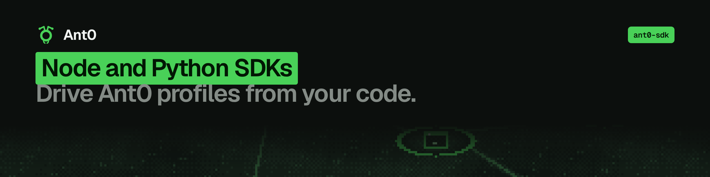

<p align="center">
  <a href="https://ant0.link"></a>
</p>

<p align="center">
  <a href="LICENSE"></a>
  <a href="https://www.npmjs.com/package/ant0-browser"></a>
  <a href="https://pypi.org/project/ant0-browser/"></a>
  <a href="https://docs.ant0.link"></a>
</p>

# ant0-sdk

**Node and Python SDKs for Ant0, a browser for automation and agents.**

Launch and control Ant0 browser profiles from your code. Both SDKs are built on Playwright.

> Part of [Ant0](https://ant0.link), a browser for automation and agents. This code talks to the Ant0
> app on your computer. The app is free for 5 profiles and needs a free account.

## Requirements

- The Ant0 app for Windows 10 or 11 (64-bit) or 64-bit Ubuntu 24.04 or Debian 13 or newer,
  installed, running and signed in: [download](https://ant0.link/download).
- Node 18 or newer, or Python 3.9 or newer.

## Quickstart

Node:

```bash
npm install ant0-browser
```

```javascript
import { launch } from "ant0-browser";

const browser = await launch({ identity: { mode: "native" } });
try {
  const page = await browser.newPage();
  await page.goto("https://example.com");
  console.log(await page.title());
} finally {
  await browser.close();
}
```

Python:

```bash
pip install ant0-browser
```

```python
from ant0browser import launch


def main():
    browser = launch(identity={"mode": "native"})
    try:
        page = browser.new_page()
        page.goto("https://example.com")
        print(page.title())
    finally:
        browser.close()


if __name__ == "__main__":
    main()
```

The same files are in [examples](examples). Each SDK has its own README with the full API:
[node](node/README.md), [python](python/README.md).

## Repository layout

| Path | Contents |
|---|---|
| `node/` | The `ant0-browser` npm package (TypeScript) |
| `python/` | The `ant0-browser` PyPI package |
| `examples/` | Runnable quickstarts |
| `docs/` | Notes for working on this repository |
| `fixtures/` | Test input shared by both SDKs |

## Documentation

- [SDK guide](https://docs.ant0.link/sdk)
- [All docs](https://docs.ant0.link)
- [Changelog](CHANGELOG.md)
- [Working on this repository](docs/DEVELOPMENT.md)

## Support

Questions and bugs go in [Issues](../../issues). For your account or billing, use the
[contact page](https://ant0.link/contact).

## Security

Please don't report security problems in public issues. See the
[security policy](https://github.com/Ant0-Browser/.github/blob/main/SECURITY.md), or use
**Security → Report a vulnerability** on this repository.

## Contributing

See the [contributing guide](https://github.com/Ant0-Browser/.github/blob/main/CONTRIBUTING.md) and
[docs/DEVELOPMENT.md](docs/DEVELOPMENT.md).

## Licence

BSD-3-Clause. See [LICENSE](LICENSE).

One test fixture, `fixtures/playwright-1.65.1-chromium-switches.js`, is an excerpt of Playwright from Microsoft, under Apache-2.0. See [fixtures/LICENSE-playwright](fixtures/LICENSE-playwright). It is not part of the published packages.

The Ant0 app, the Ant0 Browser engine and the Ant0 cloud service are proprietary and not covered by
this licence.
